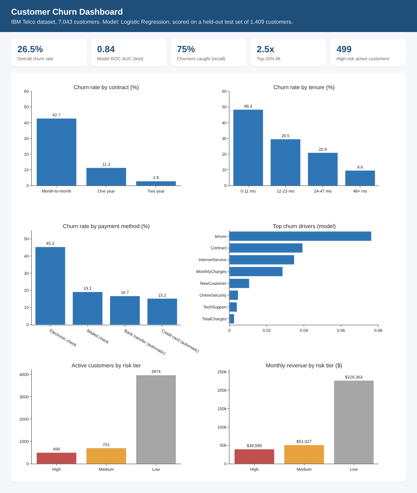

# Customer Churn Prediction & Retention Analytics

Which telecom customers are about to cancel, why, and who should the retention team call first?

This project goes from raw CSV to SQL analysis, a machine learning model, a ranked call list, and an interactive dashboard.



## Key Results

| | |
|---|---|
| Customers analyzed | 7,043 |
| Overall churn rate | 26.5% |
| Model | Logistic Regression (beat Random Forest and Gradient Boosting on 5-fold CV) |
| ROC-AUC on held-out test set | **0.84** |
| Churners caught (recall) | **75%**, up from 53% at the default threshold |
| Lift in top 20% riskiest customers | **2.5x** (66% churn vs. 26% overall) |
| Active customers flagged high-risk | 499, worth about $39.6K in monthly revenue |

## Findings

1. **Contract type is the biggest lever.** Month-to-month customers churn at 42.7%; two-year customers churn at 2.8%.
2. **The first year is the danger zone.** Customers in months 0-11 churn at 48.3%, compared with 9.6% for customers past 4 years.
3. **Add-on services build loyalty.** Internet customers with zero add-ons churn at 52%; those with all six churn at 5%.
4. **Electronic check payers churn at 45%**, about 3x the rate of autopay customers.
5. **Riskiest segment:** month-to-month fiber customers without tech support, at 57.5% churn (1,796 customers).

**Recommendation:** target new month-to-month fiber customers with an offer to move to a 1-year contract with autopay or a free tech-support add-on, starting with the model's high-risk list.

## How It Works

```
data/telco_customer_churn.csv
        │
        ├── sql/            Table setup + 9 analysis queries (CTEs, window functions, CASE, HAVING)
        │   └── run with src/run_sql.py (DuckDB, no server needed; also runs in PostgreSQL)
        │
        ├── src/train_model.py
        │     1. Clean data (11 blank TotalCharges -> 0; all are tenure-0 customers)
        │     2. Engineer features (add-on count, autopay flag, avg spend, new-customer flag)
        │     3. Compare 3 models with stratified 5-fold cross-validation
        │     4. Tune the decision threshold on out-of-fold predictions (best F1)
        │     5. Evaluate ONCE on a 20% held-out test set
        │     6. Explain the model with permutation importance
        │     7. Score every customer with out-of-fold probabilities -> risk tiers
        │
        ├── src/build_dashboard.py   ->  dashboards/churn_dashboard.html (interactive Plotly)
        └── notebooks/churn_analysis.ipynb   walkthrough with charts and findings
```

### Design decisions

- **Why logistic regression?** All three models scored within 0.004 ROC-AUC of each other. When accuracy is tied, the simpler model wins: it's easier to explain to a business team, and its probabilities are well calibrated (lowest Brier score), which matters for the revenue-at-risk numbers.
- **Why not class weighting?** Rebalancing the classes inflates predicted probabilities, which would overstate revenue at risk. Instead, the models stay unweighted and the decision threshold is tuned (0.31 instead of 0.5), which raised recall from 53% to 75%.
- **No data leakage.** The threshold is picked using training data only, the test set is used once, and customer risk scores come from out-of-fold predictions so no customer is scored by a model that trained on them.

## Run It

```bash
pip install -r requirements.txt
python src/run_sql.py          # SQL analysis
python src/train_model.py      # train, evaluate, score customers -> outputs/
python src/build_dashboard.py  # build the dashboard
```

## Limitations

- The data is a single snapshot, so the model can't see how a customer's behavior changes over time.
- A simple rule ("every month-to-month customer will churn") catches more churners (88%) but has much lower precision (43% vs. 53%), so it would waste far more retention budget on people who'd stay anyway.
- Dataset: [IBM Telco Customer Churn](https://github.com/IBM/telco-customer-churn-on-icp4d) (fictional company, public sample data).

## Tools

Python (pandas, scikit-learn, Plotly, matplotlib) · SQL (DuckDB / PostgreSQL) · Jupyter

---
Ahmad Evans · M.S. Information Systems & Business Analytics, Park University
